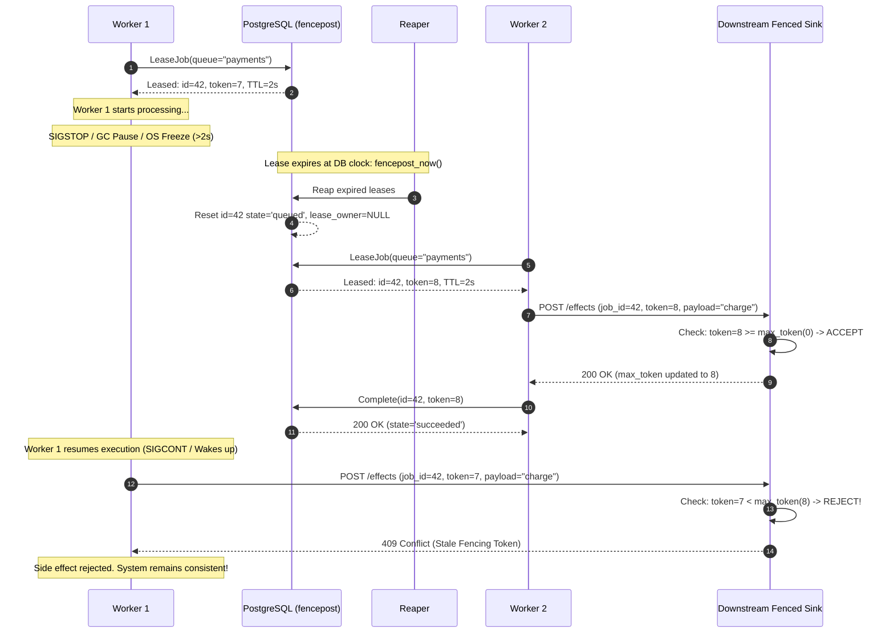

# fencepost System Design & Architecture

`fencepost` is a distributed job queue and cron scheduler built with PostgreSQL 16+, Go 1.25, and gRPC. It guarantees **effectively-once downstream side effects** under worker pauses, SIGKILL terminations, network delays, and scheduler failovers through monotonic fencing tokens, database-clock leases, and idempotent enqueue semantics.

---

## 1. System Architecture

```mermaid
flowchart TD
    Client[gRPC Clients / Producers] -->|Enqueue / Idempotent| Fencepostd1[fencepostd Replica 1]
    Client -->|Enqueue / Idempotent| Fencepostd2[fencepostd Replica 2]

    subgraph Cluster["fencepostd Daemons"]
        Fencepostd1
        Fencepostd2
        Sched1[Scheduler Leader<br/>pg_try_advisory_lock]
        Reap1[Reaper Engine]
    end

    subgraph Storage["PostgreSQL 16+ Primary"]
        JobsTable[(jobs table)]
        EventsTable[(job_events table)]
        Seq[fencing_seq SEQUENCE]
        Clock[DB Clock: fencepost_now]
    end

    Fencepostd1 -->|SKIP LOCKED & nextval| Storage
    Fencepostd2 -->|SKIP LOCKED & nextval| Storage
    Sched1 -->|Idempotent Enqueue| Storage
    Reap1 -->|Lease Expiry Reclaim| Storage

    subgraph WorkerFleet["Distributed Worker Fleet"]
        W1[Worker 1]
        W2[Worker 2 (Paused/Slow)]
    end

    W1 -->|gRPC Lease, Heartbeat, Complete| Fencepostd1
    W2 -->|gRPC Lease, Heartbeat, Complete| Fencepostd2

    subgraph ExternalSink["Downstream Fenced Sink"]
        SinkAPI[External Service / Database]
        SinkStorage[(Sink Storage: max_token)]
    end

    W1 -->|HTTP / Side-Effect (token=8)| SinkAPI
    W2 -.->|STALE Side-Effect (token=7) - REJECTED| SinkAPI
    SinkAPI --> SinkStorage
```

### Components
1. **`fencepostd` Daemon**: Stateless gRPC and HTTP admin service. Implements long-polling job leases, atomic completion/failure CAS, advisory lock scheduler leadership, and periodic lease reaping.
2. **PostgreSQL Store (`pgstore`)**: Single source of truth. Handles monotonic fencing sequences, row-level concurrency via `FOR UPDATE SKIP LOCKED`, and audit logging in `job_events`.
3. **Worker SDK (`pkg/worker`)**: Client library providing autonomous lease acquisition, automatic background heartbeating at `ttl / 3`, cancellation propagation via `context.Context` on heartbeat failure, and error handling.
4. **Fenced Sink (`cmd/sink`)**: External service validating the Kleppmann fencing condition: $token \ge max\_token$. Stale requests with older tokens are rejected with `409 Conflict`.

---

## 2. Distributed Race Condition & Fencing Token Invariant

### The Process Pause Scenario (Kleppmann Invariant)

When distributed workers execute side-effects against external APIs, storage systems, or third-party webhooks, lease timeouts alone cannot prevent duplicate side-effects. If a worker pauses (e.g., GC pause, hypervisor descheduling, SIGSTOP, or network buffer queue delay) immediately before issuing an external write, its lease may expire in PostgreSQL, allowing another worker to lease and process the job. When the paused worker resumes, it attempts to execute the same external effect.

Without fencing tokens, this results in silent duplicate writes. With monotonic fencing tokens, the downstream sink rejects the stale request:



---

## 3. Database Clock Leases & Time Integrity

### Why Only the Database Clock Is Used
Clock skew between distributed physical machines is inevitable in real-world infrastructure. NTP synchronization errors, leap seconds, VM live migrations, and hypervisor time drift routinely introduce tens to hundreds of milliseconds (and occasionally seconds) of clock variance between servers.

If `fencepost` evaluated lease expirations using local worker clocks or daemon application clocks (`time.Now()`):
1. A worker whose local clock runs slow could assume its lease remains valid long after the server marked it expired, increasing the window for split-brain execution.
2. A daemon whose local clock runs fast could prematurely reclaim active leases, causing false lease expiries and execution storms.

### The `fencepost_now()` Guarantee
All lease expirations, schedule evaluations, and job timestamps are computed strictly inside PostgreSQL using a single monotonic clock:
```sql
CREATE OR REPLACE FUNCTION fencepost_now()
RETURNS timestamptz AS $$
BEGIN
    RETURN clock_timestamp();
END;
$$ LANGUAGE plpgsql STABLE;
```
- PostgreSQL's `clock_timestamp()` returns the actual current wall-clock time at execution, rather than `NOW()` / `CURRENT_TIMESTAMP` which remains frozen at transaction start time.
- Leases are assigned with `lease_expires_at = fencepost_now() + ($3 * interval '1 millisecond')`.
- Heartbeats extend `lease_expires_at = fencepost_now() + ($2 * interval '1 millisecond')`.
- Reaper reclaims rows strictly matching `lease_expires_at < fencepost_now()`.

This eliminates all node-to-node clock synchronization requirements.

---

## 4. Lease Acquisition SQL & Concurrency

### The Atomic Lease Query
Job leasing is performed in a single PostgreSQL query using Common Table Expressions (CTEs), partial indexing, and `FOR UPDATE SKIP LOCKED`:

```sql
WITH candidates AS (
    SELECT id
    FROM jobs
    WHERE queue = $1
      AND state = 'queued'
      AND run_at <= fencepost_now()
    ORDER BY priority DESC, run_at ASC, id ASC
    LIMIT $4
    FOR UPDATE SKIP LOCKED
)
UPDATE jobs j
SET state = 'leased',
    lease_owner = $2,
    lease_expires_at = fencepost_now() + ($3 * interval '1 millisecond'),
    fencing_token = nextval('fencing_seq'),
    attempts = attempts + 1,
    updated_at = fencepost_now()
FROM candidates c
WHERE j.id = c.id
RETURNING j.id, j.queue, j.payload, j.priority, j.run_at, j.state,
          j.attempts, j.max_attempts, j.lease_owner, j.lease_expires_at,
          j.fencing_token, j.idempotency_key, j.created_at, j.updated_at;
```

### Key Concurrency Mechanics
1. **`FOR UPDATE SKIP LOCKED`**: Concurrently leasing workers do not block or wait on locks held by peer workers. Any candidate row currently locked by another transaction is immediately skipped, allowing workers to proceed concurrently without lock waits.
2. **Atomic `nextval('fencing_seq')`**: Fencing tokens are drawn directly from PostgreSQL's 64-bit sequence generator. Sequence operations in PostgreSQL are atomic, non-transactional, and strictly monotonic, ensuring every lease receives a token strictly greater than all previously issued tokens across the cluster.
3. **Partial Index Support**:
   ```sql
   CREATE INDEX idx_jobs_lease_candidate
   ON jobs(queue, priority DESC, run_at ASC)
   WHERE state = 'queued';
   ```
   The index only indexes rows in `'queued'` state. Once a row is updated to `'leased'`, it is excluded from future index scans, minimizing the index footprint and cache overhead.

---

## 5. Effectively-Once Delivery Argument

`fencepost` achieves **effectively-once downstream side effects** by composing three foundational guarantees:

$$\text{Effectively-Once} = \text{Idempotent Enqueue} + \text{At-Least-Once Execution} + \text{Fenced Downstream Effects}$$

1. **Idempotent Enqueue**: Producers supply an `idempotency_key`. The unique index `idx_jobs_queue_idempotency` guarantees that duplicate enqueue requests (due to client retries or network drops) return the existing `job_id` rather than inserting a duplicate job.
2. **At-Least-Once Execution**: If a worker crashes, loses power, or pauses past its lease TTL, the reaper reclaims the job and requeues it with exponential backoff until `max_attempts` is reached or the job succeeds.
3. **Fenced Downstream Effects**: Downstream sinks track the maximum observed fencing token per `job_id`. Stale attempts from resumed or zombie workers carry older tokens and are rejected ($token < max\_token$). Only the newest valid worker attempt can apply state changes.

---

## 6. Leader Election & Scheduler Mechanics

### PostgreSQL Advisory Locks
Cron schedule dispatching is centralized through a leader-elected scheduler using PostgreSQL session-level advisory locks:

```sql
SELECT pg_try_advisory_lock(424242);
```

- **Non-blocking acquisition**: Multiple `fencepostd` replicas can run concurrently. On startup and during background polling, each daemon attempts to acquire lock `424242`.
- **Automatic failover**: Because the lock is session-scoped, if the leader process dies, crashes, or closes its TCP connection, PostgreSQL automatically releases the advisory lock. The standby daemon acquires the lock on its next poll cycle and assumes leadership.
- **Idempotent Dispatch**: When the leader schedules a cron job, it enqueues with idempotency key `schedule_id:unix_time`. Even if leadership transitions mid-minute, double-firing is impossible.

### Caveats & Split-Brain Boundaries
1. **TCP Connection Liveness**: Advisory locks belong to the underlying database session. If an OS pause or network partition causes silent packet loss, the leader might consider itself the leader until its TCP keepalive expires or its next query fails.
2. **Partition Behavior**: If the PostgreSQL primary becomes unreachable, all scheduler replicas step down from leadership until a verified database session is re-established.

---

## 7. Comparison with Hookrelay

> While **hookrelay** focuses on resilient HTTP webhook ingestion and outward dispatching with Redis-backed delivery guarantees, **fencepost** provides a general-purpose PostgreSQL-native distributed job queue and cron scheduler featuring monotonic fencing tokens to enforce strict downstream linearizability under worker pauses and crashes.
